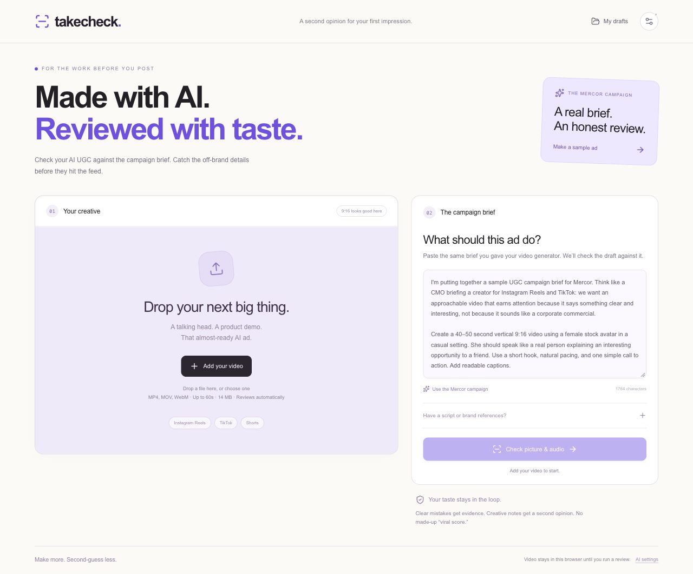

# Takecheck

### Make more. Second-guess less.

**A second opinion for AI-generated UGC—before it goes live.**

Takecheck reviews the actual video against the campaign brief, highlights moments worth checking, and helps creative teams turn feedback into a clear brief for the next take.

**[Open the live demo →](https://takecheck-nine.vercel.app/)** · [Product specification](docs/product-spec.md) · [Demo guide](docs/demo-runbook.md)



## From creative brief to a better next take

1. **Set the brief.** Use the same instructions you gave your video generator. Add an approved script or reference images when relevant.
2. **Upload the take.** Review starts automatically. Connect Gemini for spoken-content and campaign-brief analysis; local picture and audio checks also work without a key.
3. **Inspect the evidence.** Click a timeline flag to jump to the source moment, see the relevant frame, and compare what was expected with what was observed.
4. **Choose the changes.** Confirm or dismiss findings, then export a correction brief containing only approved changes.

Supports videos up to **60 seconds and 64 MB**. H.264/AAC MP4 is recommended; WebM and MOV support depends on browser codecs.

## How the review works

Takecheck combines multimodal judgment with separate media measurements and an explicit way to say **cannot verify**.

| Stage | What happens |
| --- | --- |
| **Measure picture and audio** | Local face detection, frame comparisons, and audio-energy measurements identify candidate presenter freezes and near-silent gaps. |
| **Observe before judging** | Gemini watches and listens to the video without the campaign brief, recording timestamped source observations. |
| **Compare with the brief** | A fresh model context evaluates those observations against the approved requirements. Candidates must reference valid evidence IDs and timestamps. |
| **Recheck flagged moments** | Candidate windows receive a fresh video read. Unsupported observations are withheld. |
| **Cross-check the reviewer** | Positive delivery claims that conflict with measured playback signals are downgraded. Transcript spans overlapping near silence are marked uncertain. Relevant visible-text quotes can receive a separate OCR check. |
| **Keep a human in control** | Reviewers inspect the source and decide which changes belong in the next-take brief. |

The same Gemini model performs the initial read and reread, so repeated observations are consistency evidence rather than independent proof. Takecheck combines pretrained models and application-level verification; it does not train a new model.

## Built with

| Layer | Technology |
| --- | --- |
| Application | Next.js, React, TypeScript, Tailwind CSS |
| Multimodal review | Google Gemini through the Vercel AI SDK |
| Picture and audio checks | MediaPipe, Web Audio API, HTML video, Canvas |
| Visible-text verification | Tesseract.js |
| Local projects and replays | IndexedDB |
| Production hosting | Vercel |
| Larger video uploads | Chunked upload through the Gemini Files API |

Gemini **3.5 Flash Lite** was used for the verified live video tests. The connection flow discovers available models and tests generation access before selecting a working model.

## Run locally

Requires **Node.js 22.13+**.

```bash
npm ci
node scripts/prepare-ocr.mjs
npm run dev:next
```

Open [localhost:3002](http://localhost:3002). Connect your Gemini API key in **AI settings**, add your campaign brief, and upload a video.

```bash
# TypeScript and automated checks
npm run typecheck
npm test

# Production build
npm run build:vercel
npx next start --port 3000
```

The repository also retains a Vinext/Cloudflare build for the original Sites deployment through `npm run dev` and `npm run build`.

## Verified results

**37 automated tests passed**, covering evidence grounding, invalid timestamps, reread disagreement, uncertainty handling, cache identity, confirmed-only exports, and upload-destination validation.

| Diagnostic | Observed result |
| --- | --- |
| Untouched talking-head clip | No local playback flags; approximately **2.1s** end to end with the runtime loaded. |
| Controlled freeze and mute | Local checks identified both injected faults. |
| Live Gemini review | A 12-second clip completed in **26.4s** end to end. A conflicting positive model assessment prompted the playback cross-check. |
| Visual requirement test | Gemini flagged a product-only cutaway against an explicit presenter-visibility requirement and reproduced the cue on reread; **21.2s** end to end. |

These are short diagnostic runs, not a general accuracy or latency benchmark. Sample footage comes from [HeyGen’s public avatar showcase](https://www.heygen.com/avatars); controlled edits and diagnostic briefs are documented in [the media notes](public/demo/README.md).

## Data and review boundaries

- Projects, source videos, saved reviews, and reviewer decisions are stored locally in the browser. There is no cross-device project sync.
- API keys stay in the current tab’s memory. Application code does not persist or log them; refreshing requires reconnecting.
- Running AI review sends media and the brief to Google. Larger videos use Google’s Files API for processing.
- Findings and timestamps can be wrong. Intentional pauses, still shots, and creative choices need human interpretation.
- Takecheck does not establish whether a person is real, measure lip synchronization, or predict virality, conversions, or legal compliance.

---

Built for **Mercor Hack Day at Georgia Tech**: evaluating specialized AI output through source evidence, separate checks, and human expertise.
